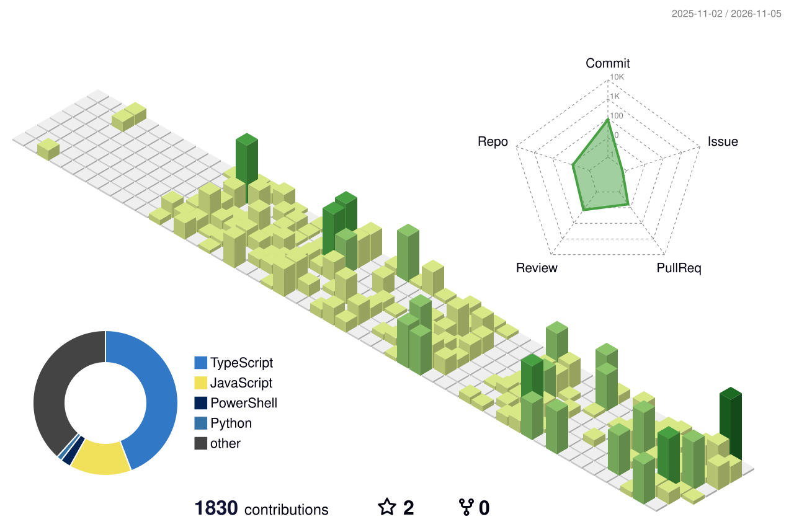

# Hi, I'm Kurt Axcel!
- **Education:** Studying BS Computer Science at Cavite State University - Main Campus.
- **Location:** Based in Cavite, Philippines.
- **Focus:** Building AI-driven integrations, high-performance full-stack applications, and immersive motion design.
- **Philosophy:** Bridging the gap between raw engineering performance and premium aesthetics.

**What I build:** custom-built AI for businesses in the Philippines and abroad, designed around how each business already works. I build in public at [blog.kurtaxcel.com](https://blog.kurtaxcel.com). Have a problem in mind? Message me through [links.kurtaxcel.com](https://links.kurtaxcel.com).
- **[Project TLNTIK](https://tlntik.kurtaxcel.com), spot.ph, Iwas Scam, better-post**: shipped projects, documented on my [blog](https://blog.kurtaxcel.com).

📩 Work with me: **[hello@kurtaxcel.com](mailto:hello@kurtaxcel.com)** · All links: [links.kurtaxcel.com](https://links.kurtaxcel.com)

---

## Featured Projects

Here is a curated showcase of my engineering work, ranging from academic applications to advanced full-stack and mobile solutions.

### [Project TLNTIK](https://tlntik.kurtaxcel.com/)
> **Active Guide & Tourism Platform for the Nasugbu Trilogy (Mt. Talamitam, Mt. Lantik, & Mt. Apayang)**

A highly secure, full-stack platform designed to connect hikers with local guides, featuring real-time tools and 3D terrain exploration.
- **Key Features:** Premium glassmorphic interface, real-time "Online Hikers" lounge (Presence), live view counters, interactive 3D terrain maps (MapLibre GL + Esri World Imagery), guide booking scheduler, and downloadable verified hiker certificates.
- **Security & Infrastructure:** A+ rated security implementation. Progressive rate-limiting, strict CSP, Row Level Security (RLS) policies, input sanitization, anti-debug hooks, and Upstash Redis caching for 10k+ requests/sec.
- **Stack:** `Next.js 16 (App Router)` • `Tailwind CSS v4` • `Supabase (PostgreSQL + Auth + Realtime)` • `Redis` • `MapLibre GL` • `Sentry` • `PostHog` • `Vercel`

---

### [spot.ph (Enhanced)](https://github.com/devkurtaxcel/ITECH50B-SPOT.PH.git) & [spotph (Original)](https://www.facebook.com/share/p/1CWKqe7SNP/)
> **Indang Terminal Public Transport Transparency Platform**

An interactive system built to ease the daily commutes of students and locals by eliminating transport uncertainty.
- **Enhanced Version:** Features a premium responsive glassmorphism interface built in partnership with co-developer **Kenji Buena**. Includes a real-time transport tracker (MapLibre GL + CARTO Voyager), automated digital fare calculator (PWD/student pricing), emergency driver directory, and **SpotBot**—an AI-powered chatbot running Llama 3.3 via GROQ API, optimized for mobile screens.
- **Original Version (ITEC 50B):** The prototype school project that validated terminal tracking requirements, laying the architectural groundwork for the enhanced glassmorphic edition (first showcase detailed in the Facebook link).
- **Stack:** `Vanilla JS` • `HTML5 / CSS3` • `GSAP & Lottie` • `MapLibre GL` • `GROQ / Llama 3.3`

---

### Iwas Scam
> **AI-Powered Mobile Scam Detection App — Built for the DevKada Hackathon**

A trust-centric mobile monorepo aimed at shielding users from phishing and social engineering vectors using hybrid detection.
- **Resources:** [Case Study](https://www.kurtaxcel.com/projects/iwasscam) • [Hackathon Documentation](https://blog.kurtaxcel.com/blog/devkada-iwas-scam-hackathon)
- **Key Features:** High-speed heuristic engine (regex patterns for urgency/phishing triggers), AI-powered message parser (GPT-4o-mini analyzing semantic triggers), unified status verdict dashboard (SAFE / SUSPICIOUS / DANGEROUS), and backend mock analysis fallback.
- **Stack:** `React Native (Expo)` • `NativeWind v4` • `TanStack Query` • `Express.js` • `TypeScript` • `OpenAI API` • `Supabase`

---

### [BetterIndang LGU Starter Kit](https://betterindang.org/)
> **Modern Government Website Template for Local Government Units in the Philippines**

An accessible, fast, and multilingual starter kit template to bridge the digital gap for local municipalities.
- **Key Features:** Full multilingual localization (English, Filipino, Cebuano), strict WCAG 2.1 accessibility compliance, YAML-based content system for non-technical admins, and robust built-in SEO optimizations.
- **Stack:** `React` • `TypeScript` • `Vite` • `Tailwind CSS v4` • `i18next` • `react-helmet`

---

### [Asset — Personal Digital Portfolio](https://www.kurtaxcel.com/)
> **High-Performance Portfolio & Brand Source of Truth**

A state-of-the-art developer landing page engineered for zero-stutter navigation and unique interactive elements.
- **Key Features:** **Nexus Automation Engine** (interactive data flow simulator using GSAP timelines), **Vault Security Shield** (reactive SVG security visualizer), and a canvas-based neural node background optimized with short-circuit O(n) proximity checks for smooth 60FPS rendering.
- **Stack:** `Next.js 15 (App Router)` • `React 19` • `GSAP` • `Framer Motion` • `Tailwind CSS`

---

## GitHub Metrics

### Snake Contribution Game

  <picture>
    <source media="(prefers-color-scheme: dark)" srcset="https://raw.githubusercontent.com/devkurtaxcel/devkurtaxcel/main/dist/github-contribution-grid-snake-dark.svg">
    <source media="(prefers-color-scheme: light)" srcset="https://raw.githubusercontent.com/devkurtaxcel/devkurtaxcel/main/dist/github-contribution-grid-snake.svg">
    
  </picture>

### 3D Contribution Calendar

  

### Core Activity & Streaks

  

  

  

## [Achievements & Milestones](https://blog.kurtaxcel.com/)

  

### Cloud & Infrastructure
*   **[Google Cloud Study Jam Winner](https://blog.kurtaxcel.com/blog/cloud-study-jam-certificates)** — Recognized for designing a winner-grade *Scalable Event Ticketing System*; learned compute resource optimizations, systems architecture, and observability paths on GCP.
*   **[AWS Cloud Practitioner (CLF-C02)](https://blog.kurtaxcel.com/blog/aws-cloud-practitioner-datacamp)** — Learned global infrastructure, EC2/S3/RDS provisioning, security best practices (IAM), cost modeling, and the shared responsibility model.
*   **[Microsoft Azure Fundamentals (AZ-900)](https://blog.kurtaxcel.com/blog/azure-fundamentals)** — Completed the cloud trifecta, focusing on Microsoft Azure architecture, serverless/container systems, cost management, and resource governance.

### AI, DevOps & Hackathons
*   **[AI Fundamentals](https://blog.kurtaxcel.com/blog/ai-fundamentals-datacamp)** — Attained advanced-level track completion covering Machine Learning concepts, Transformer LLM architectures, RLHF alignment, generative models, and ethical AI governance.
*   **[GitHub Foundations](https://blog.kurtaxcel.com/blog/github-foundations)** — Certified in Git version control branching/merging strategies, complex conflict resolution, and enterprise repository workflows.
*   **[CodeKada Hackathon 2026](https://blog.kurtaxcel.com/blog/devkada-iwas-scam-hackathon)** — Built **Iwas Scam** in 7 days as part of Team Trio-Force, delivering an AI-driven smishing and screenshot threat scanning mobile app.

---

## Let's Connect!

- **LinkedIn:** [Kurt Axcel Peñano](https://www.linkedin.com/in/pe%C3%B1anokurtaxcel/)
- **More about me:** [Links](https://links.kurtaxcel.com/)

---

  <i>"Combining deterministic performance with creative visuals."</i>

